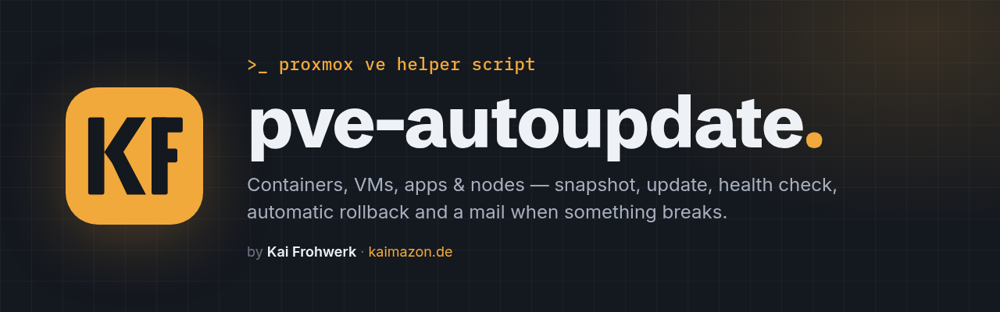
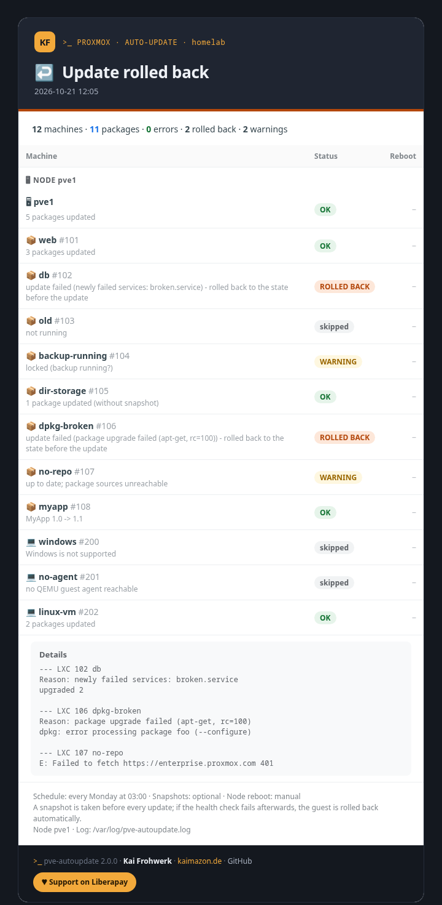

<div align="center">



**Unattended updates for Proxmox VE: containers, VMs, apps and the nodes themselves.**
**With a snapshot before every update, automatic rollback and a mail report when something goes wrong.**

[](LICENSE)


[](https://liberapay.com/Viollent_Tech/donate)
[](https://kaimazon.de)

[Deutsch ↓](#-deutsch)

</div>

---

## ✨ Features

- **Single node or cluster.** Nodes, IPs and guests are detected automatically; there is nothing to hard-code.
- **Choose what gets updated:** all containers (new ones join automatically, exceptions possible), a fixed selection, or none.
- **Every package manager:** `apt`, `apk`, `dnf`/`yum`, `zypper` and `pacman` inside LXC containers. Linux VMs are updated via the QEMU guest agent.
- **Windows VMs too:** Windows Update through the QEMU guest agent: security and quality updates, no feature upgrades, no drivers. The VM reboots to finish them (more rounds if follow-up updates show up), and afterwards the script checks that it is back and every automatic service runs again. If not, it rolls back to the snapshot. Nothing to install in the guest besides the guest agent.
- **Apps inside the guests:**
  - Docker Compose stacks (`pull` + `up -d`)
  - AdGuard Home
  - Forgejo (with checksum verification)
  - Uptime Kuma (stays within the major version)
  - Beszel hub and agent
  - your own services through simple drop-in files
- **Safety net:** snapshot → update → health check → **automatic rollback** if anything broke. The health check looks for:
  - newly failed systemd units
  - stopped or unhealthy Docker containers
  - app-specific checks
  - the package manager's exit code
- **Proxmox nodes too:** optional, with **rolling reboots** after a kernel update. Nodes reboot one at a time, and the script waits for quorum after each one. The node running the schedule reboots last, and a post-check after boot verifies that everything is back.
- **Mail report:** never, only on problems, on changes, or always. It is sent through the Proxmox mail system (postfix) or your own SMTP server (e.g. Gmail app password), as a clean HTML report with a plain-text fallback.
- **Schedule and time window:** daily, weekly, monthly (first weekday) or any systemd `OnCalendar` expression. Optionally a window such as `02:00-05:00`: whatever is not done by the end waits for the next run, reboots included. Manual runs outside the window ask first (`--ignore-window` forces them), dry runs are always allowed.
- **English and German** for menus, messages and mails.
- **Safe by design:**
  - Backups are respected: locked guests are skipped.
  - Scheduled runs only use the locally installed copy; no code is downloaded at runtime.
  - Self-updates show a diff and the SHA256 before anything is replaced.
  - The update check only looks: it compares with GitHub at most every 12 hours. Installing is always your decision (`self-update` or the button in the web UI).

## 🚀 Install

Run this **as root in the shell of one Proxmox node**. In a cluster, one node is enough.

```bash
bash <(curl -fsSL https://raw.githubusercontent.com/frohkai/PVE_Autoupdate/main/pve-autoupdate.sh)
```

The script shows its SHA256 and installs itself to
`/usr/local/sbin/pve-autoupdate`. Then a wizard asks six questions:

| Step | Question |
|---|---|
| 1 | Which containers / VMs? (all, selection, none) |
| 2 | Update the nodes and the apps inside the guests too? |
| 3 | Snapshots (`optional` / `required` / `off`) and automatic reboots? |
| 4 | How often, and from when to when? (daily / weekly / monthly / custom, time window e.g. `02:00-05:00`) |
| 5 | Mail notification? When and where to? |
| 6 | Web UI? Yes: a small container with a web interface. No: everything stays in the terminal. |

At the end it offers a test mail and a dry run that changes nothing, and - if you chose it - sets up the web UI.

## 🖥️ Web UI

Optional - the wizard asks whether you want it. Without it you use everything in the terminal (`pve-autoupdate`),
and you can add it later any time with `pve-autoupdate ui-install`.

A small Debian container (1 core, 256 MB RAM, 2 GB disk) with a web interface: overview of nodes,
containers and VMs, start checks and updates, live view, history. You sign in with your **Proxmox user**
(realms and 2FA work; `Sys.Audit` may look, `Sys.Modify` may start updates).

```bash
pve-autoupdate ui-install
```

The wizard asks for storage, bridge and DHCP or a fixed IP - everything else is set up by itself:
Debian template, packages, TLS certificate, a service user, an SSH key that may **only** run
`pve-autoupdate` on this node (forced command), the pinned SSH host key and API certificate (a renewed
certificate is taken over only after the node confirms it over SSH), and the service. At the end it
prints the address, e.g. `https://192.168.1.50:8443`. The container is tagged `pve-autoupdate` and is
itself kept up to date.

Without questions: `pve-autoupdate ui-install --yes --storage local-lvm --bridge vmbr0 --ip 192.168.1.50/24 --gw 192.168.1.1`
(also `--ctid`, `--vlan`, `--hostname`). `ui-update` copies a new version in, `ui-remove` removes the container
and its access.

## 🧭 Usage

Run `pve-autoupdate` (or the one-liner again) to open the menu:

```
 Run updates now              Dry run (check only)       Change settings
 Show status                  View log                   Send test mail
 Web UI                       Update pve-autoupdate      Language / Sprache
 About & support ♥            Uninstall
```

Or use the commands directly:

| Command | |
|---|---|
| `pve-autoupdate run` | run updates now |
| `pve-autoupdate run --dry-run [--mail]` | check only, change nothing |
| `pve-autoupdate setup` | change settings |
| `pve-autoupdate status` | settings, next run, last log lines |
| `pve-autoupdate test-mail` | send a test mail |
| `pve-autoupdate self-update` | update the script (diff + SHA256) |
| `pve-autoupdate update-check` | look for a new version on GitHub (installs nothing) |
| `pve-autoupdate ui-install` / `ui-update` / `ui-remove` | web UI container |
| `pve-autoupdate uninstall [--purge]` | remove |

## 🧩 Your own services

Drop a file into `/etc/pve-autoupdate/services.d/<name>.conf`. A template is created as
`example.conf.example`:

```sh
NAME="Vaultwarden"
TARGET="100"                 # guest ID(s) or node name
VERSION_CMD='...'            # optional, shows "1.32 -> 1.33" in the mail
UPDATE_CMD='...'
HEALTH_CMD='...'             # exit 0 = healthy, otherwise rollback
```

## 📬 Example report



## ⚠️ Good to know

- Snapshots need LVM-thin, ZFS, Ceph or qcow2. On `Directory` storage with raw images use
  `optional` (update without a net) or `required` (skip the guest).
- The schedule runs on the node where you installed it. If that node is down, the run is skipped.
- A 2-node cluster without a QDevice loses quorum while one node reboots.
- Windows VMs need the QEMU guest agent from the [virtio-win](https://pve.proxmox.com/wiki/Windows_VirtIO_Drivers) ISO and "QEMU Guest Agent" enabled in the VM options. Windows Update can take 30-60 minutes per VM; the limits are `WIN_UPDATE_TIMEOUT` and `WIN_REBOOT_TIMEOUT` (minutes) in the config. Services that stop on their own can be added to `WIN_IGNORE_SERVICES`.
- Don't schedule updates during your backup window. Locked guests are skipped and stay outdated until the next run.
- Config: `/etc/pve-autoupdate/config` (chmod 600, may contain the SMTP password). After editing
  it by hand, run `pve-autoupdate setup --apply`.
- Log: `/var/log/pve-autoupdate.log`
- Prefer the plain look? `PVE_AUTOUPDATE_THEME=classic pve-autoupdate` (or `NO_COLOR=1`) switches to the default terminal and whiptail colours.

## ♥ Support

pve-autoupdate is free and stays free. If it saves you time, I appreciate your support on Liberapay:

<a href="https://liberapay.com/Viollent_Tech/donate"></a>

Bug reports and feature ideas are welcome as issues. Pull requests are reviewed, but I decide what gets merged.

---

## 🇩🇪 Deutsch

**Automatische Updates für Proxmox VE: Container, VMs, Anwendungen und die Nodes selbst.**
Vor jedem Update wird ein Snapshot angelegt. Schlägt danach etwas fehl, wird automatisch zurückgesetzt und eine Mail verschickt.

### Installation

Als **root in der Shell eines Proxmox-Nodes** ausführen. Im Cluster reicht ein Node.

```bash
bash <(curl -fsSL https://raw.githubusercontent.com/frohkai/PVE_Autoupdate/main/pve-autoupdate.sh)
```

Beim Start wählst du **Deutsch** aus. Danach fragt der Assistent:

1. welche Container und VMs aktualisiert werden
2. ob Nodes und Anwendungen dazugehören
3. Snapshots und Neustarts
4. wie häufig und in welchem Zeitfenster (z. B. 02:00-05:00 - was bis 05:00 nicht fertig ist, auch Neustarts, wartet auf den nächsten Lauf)
5. ob und wohin eine Mail geht
6. ob du eine Weboberfläche willst (eigener kleiner Container) - ohne läuft alles im Terminal

Am Ende gibt es eine Testmail und einen Testlauf, der nichts verändert, und - wenn gewünscht - die Weboberfläche.

### Weboberfläche

Die Weboberfläche ist optional, der Assistent fragt danach. Nachrüsten geht jederzeit mit `pve-autoupdate ui-install`.

`pve-autoupdate ui-install` (oder im Menü „Weboberfläche“) legt einen kleinen Debian-Container an
(1 Kern, 256 MB RAM, 2 GB) und richtet alles selbst ein: Pakete, Zertifikat, einen SSH-Schlüssel, der nur
`pve-autoupdate` auf diesem Node ausführen darf, und den Dienst. Gefragt wird nur nach Speicher, Bridge und
DHCP oder fester IP. Angemeldet wird mit deinem **Proxmox-Benutzer** (auch mit 2FA). Am Ende steht die
Adresse da, z. B. `https://192.168.1.50:8443`.

### Bedienung

`pve-autoupdate` aufrufen öffnet das Menü mit diesen Punkten:

- Updates jetzt
- Testlauf
- Einstellungen
- Status
- Log
- Testmail
- Weboberfläche
- Selbst-Update
- Sprache
- Über & Unterstützen
- Deinstallieren

Die Befehle aus der Tabelle oben funktionieren genauso.

Ob es eine neue Version gibt, zeigen das Menü, `pve-autoupdate status` und die Weboberfläche (Banner und „Einstellungen → Programm-Updates“). GitHub wird höchstens alle 12 Stunden gefragt; installiert wird nur, wenn du es auslöst – mit `pve-autoupdate self-update` oder dem Button in der Weboberfläche.

### Was passiert pro Gast

1. Ist der Gast gestoppt, ein Template oder gesperrt (zum Beispiel durch ein laufendes Backup), wird er übersprungen.
2. Snapshot `autoupdate` anlegen.
3. Pakete aktualisieren mit dem passenden Paketmanager: apt, apk, dnf/yum, zypper oder pacman.
4. Anwendungen aktualisieren: Docker Compose, AdGuard Home, Forgejo, Uptime Kuma, Beszel und eigene Dienste.
   Bei **Windows-VMs** stattdessen Windows Update über den Guest-Agent (Sicherheits- und Qualitätsupdates, keine Funktionsupgrades), danach Neustart, bei Folge-Updates auch mehrere Runden.
5. Health-Check: neu ausgefallene Dienste, gestoppte oder „unhealthy“ Container, Dienst-Checks, Paket-Fehler. Bei Windows: ist die VM nach dem Neustart zurück, und laufen alle automatischen Dienste wieder?
6. Bei grünem Check wird der Snapshot gelöscht. Bei rotem Check wird der Gast **zurückgesetzt** und neu gestartet, und du bekommst eine Mail.

Danach kommen die Nodes dran und starten bei Bedarf **nacheinander** neu, mit Quorum-Prüfung und Nachkontrolle.

### Unterstützen

pve-autoupdate ist und bleibt kostenlos. Wenn es dir Zeit spart, freue ich mich über Unterstützung auf Liberapay:

<a href="https://liberapay.com/Viollent_Tech/donate"></a>

---

<div align="center">

<br>
<sub><code>&gt;_</code> Made by <b>Kai Frohwerk</b> · <a href="https://kaimazon.de">kaimazon.de</a> · <a href="LICENSE">MIT License</a></sub>

</div>
